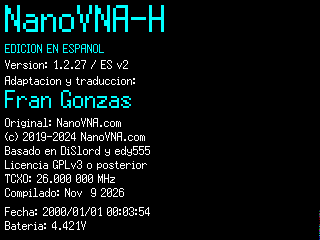

# NanoVNA-H — Edición Española v2

**Firmware 1.2.27 adaptado al español por Fran Gonzas.** Proyecto comunitario no oficial basado en [NanoVNA-H](https://github.com/hugen79/NanoVNA-H), revisión `a629229` (20 de febrero de 2024).



## Características

- Traducción al español de los menús, opciones principales, teclado numérico y estados de la interfaz.
- Pantalla **AJUSTES → VERSIÓN** personalizada, con el crédito «Fran Gonzas» y los créditos originales.
- Conserva los cálculos RF, S11/S21, calibraciones, comunicación USB y comandos de consola del proyecto base.
- Los textos de pantalla utilizan ASCII (sin acentos), por compatibilidad con las fuentes gráficas incluidas.
- Basado en el firmware **NanoVNA-H MS5351, 320 × 240 píxeles**, no en las variantes SI, SM_ST ni H4.

## Equipo en el que se ha comprobado

- Modelo anunciado por el sistema: **NanoVNA-H**, procesador STM32F072xB / Cortex-M0.
- Microcontrolador marcado físicamente **STM32F072C8T6**.
- DFU anunció **128 KiB de Flash**; se realizó lectura íntegra antes de programar. **IMPORTANTE:** el marcado C8 especifica 64 KiB nominales; no debe asumirse que todos los equipos disponen de 128 KiB accesibles.
- Firmware original previamente instalado: `NanoVNA-H-MS_20240220.bin`, coincidente byte por byte con la imagen oficial.
- Actualización ES v2 probada: escritura DFU, reinicio, comunicación USB, estado de calibración y captura real de la pantalla VERSIÓN.

**Aviso:** no grabes esta imagen en un equipo distinto sin verificar hardware, variante de reloj, capacidad de Flash y método de recuperación. No está garantizada la compatibilidad con clones.

## Archivos

- `firmware/NanoVNA-H-MS_1.2.27_ES-v2.bin` — binario de firmware probado.
- `firmware/NanoVNA-H-MS_1.2.27_ES-v2.hex` — formato Intel HEX.
- `firmware/SHA256SUMS.txt` — comprobación de integridad.
- `traduccion_es_v2.patch` — cambios completos de `ui.c`: traducción y pantalla de créditos.
- `docs/pantalla-version-es-v2.png` — captura real por USB.

## Compilación

Necesitas `git`, `bsdtar`, `make` y `arm-none-eabi-gcc` (probado con **xPack 12.3.1**).

Este repositorio incluye el parche `traduccion_es_v2.patch`. El script recupera el **código fuente original exacto**, aplica la traducción y personalización de `ui.c`, extrae la biblioteca modificada `ChibiOS.7z` y construye el firmware:

```bash
sh reconstruir_y_compilar.sh
```

Los archivos resultantes se generan en `NanoVNA-H-original/build/H.bin`, `H.hex` y `H.elf`. La ejecución del script requiere conexión a internet para clonar el proyecto original. El binario ES v2 ocupa **90.920 bytes**, por lo que no cabe en una Flash de 64 KiB.

## Precauciones de actualización

Antes de escribir, entra en el modo DFU y verifica con `dfu-util -l` que el dispositivo presenta el identificador esperado y capacidad suficiente. Guarda una **copia completa de su Flash** y conserva el firmware oficial correspondiente, además de tus ajustes y calibraciones. La instrucción de programación utilizada en la unidad de prueba fue:

```bash
dfu-util -d 0483:df11 -a 0 -s 0x08000000:leave -D firmware/NanoVNA-H-MS_1.2.27_ES-v2.bin
```

**Este comando escribe la Flash.** Ejecútalo únicamente si has verificado la compatibilidad y aceptas el riesgo de recuperación por DFU/SWD. La distribución no debe interpretarse como certificación de precisión RF.

## Autoría y licencia

**Adaptación y traducción al español:** Fran Gonzas.

**Firmware original:** NanoVNA.com. Basado en el trabajo de **@DiSlord** y **@edy555**, y en la distribución de [hugen79/NanoVNA-H](https://github.com/hugen79/NanoVNA-H). Se conserva su atribución y la licencia **GNU GPL versión 3 o posterior** para el código afectado. Consulta `LICENSE` y las licencias correspondientes de cada componente y biblioteca incluida.

Esta adaptación **no es una versión oficial del fabricante**.

## Historial

- **ES v1:** menús principales, submenús, teclado y estados en español.
- **ES v2:** pantalla de versión completamente reorganizada en español con el reconocimiento a Fran Gonzas; verificada con captura real de la pantalla.
